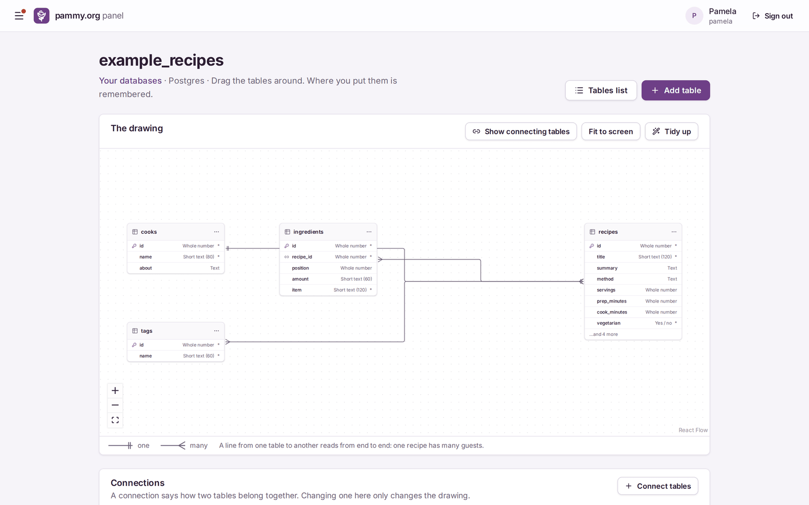
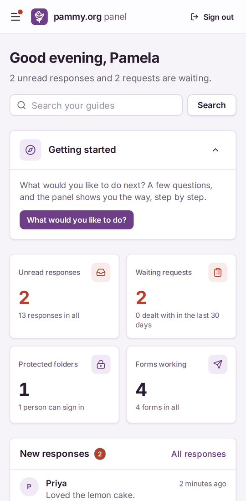
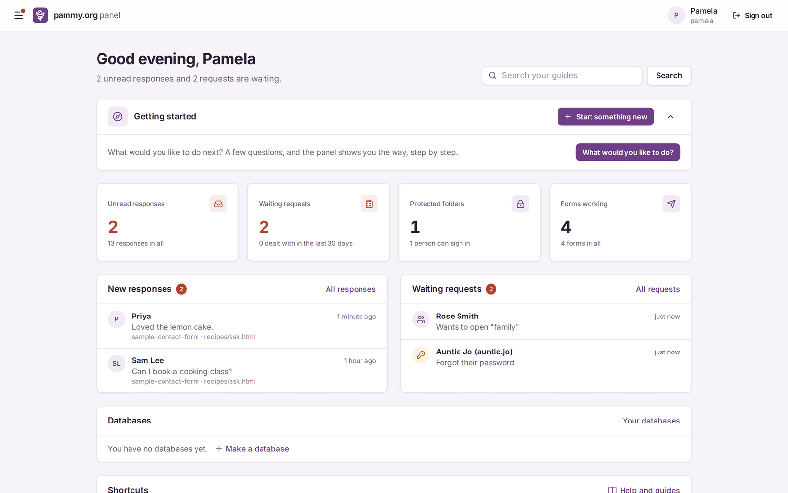
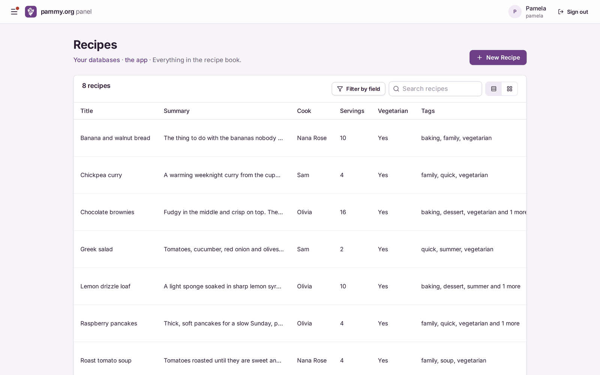
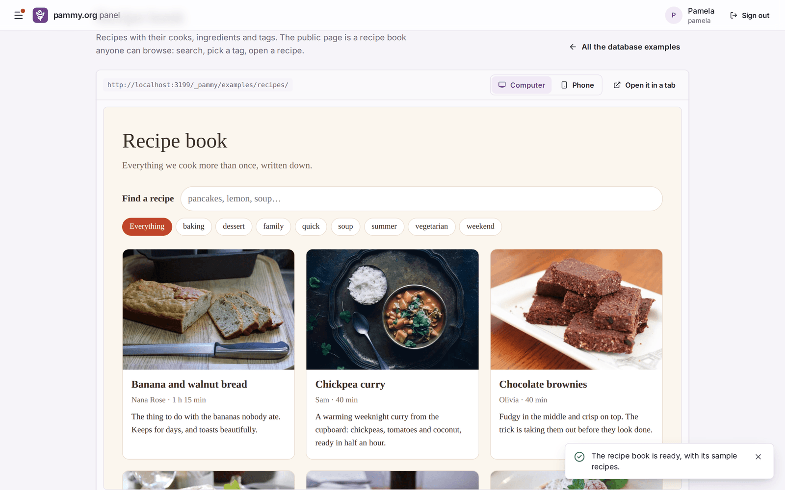
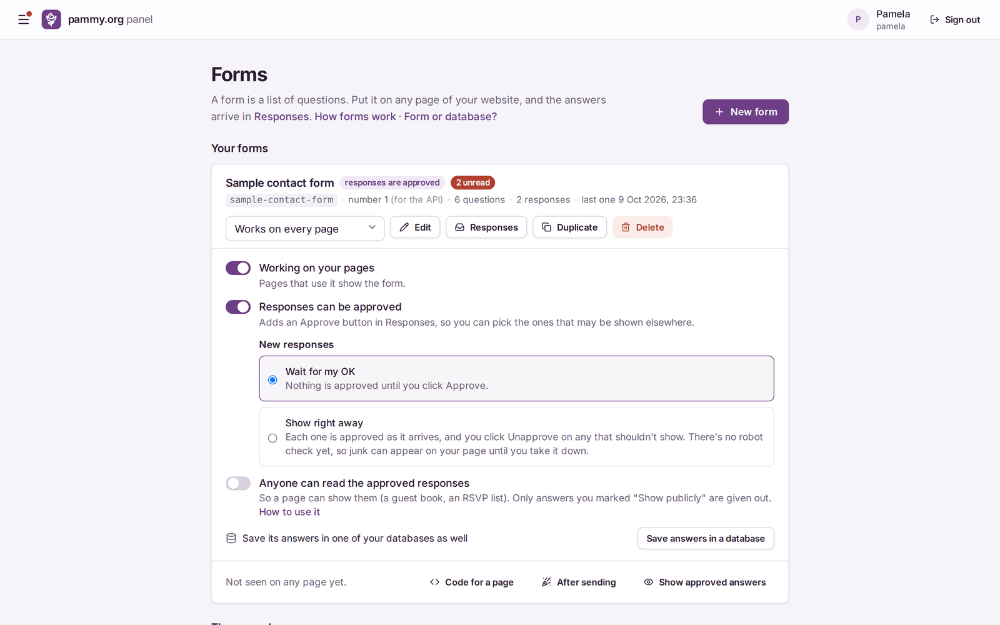
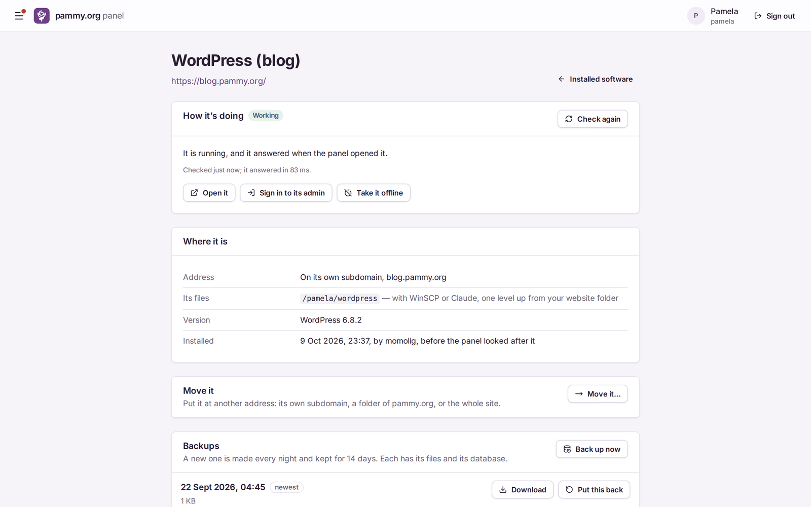
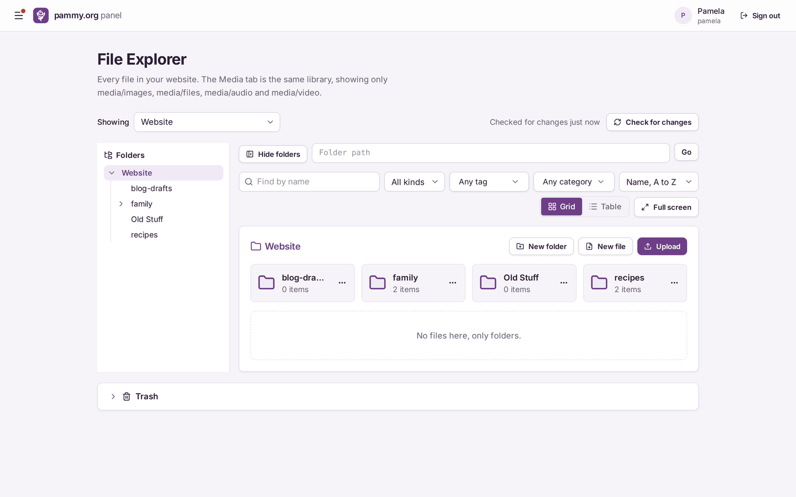

# PammyPanel

A self-hosted web control panel. It lets a non-technical site owner run her own website, forms, media and databases from a phone. It runs two live sites today: **pammy.org**, for one site owner, and **lesfleursdelanuit.com**, a five-person setup that also hosts other apps.

I designed and directed PammyPanel and built it with [Claude Code](https://claude.com/claude-code). It is about 100,000 lines of TypeScript, with 71 unit test files and 65 Playwright end-to-end specs. Every release runs a verify script on the live server before it counts as installed.

## Why it exists

Pamela built websites in the FTP days. She knows HTML and CSS, some JavaScript and very little SQL. She wanted interactive sites, like a blog, a guest book, an RSVP list or a recipe book, without handing a stranger root on her server or learning a hosting dashboard. PammyPanel gives her those features in plain words, with guides written for her.

## Screenshots

These come from the end-to-end test server, so the people and recipes are made-up test data.

<p align="center">
  
  
</p>
<p align="center"><b>Studio</b>: tables and their connections, drawn and dragged &nbsp;·&nbsp; <b>On a phone</b>: the whole panel works at phone width</p>

| | |
|---|---|
|  |  |
| **Dashboard**: what needs attention today | **App view**: a database table as a friendly list |
|  |  |
| **Example site**: a public page reading the same database | **Forms**: switches in plain words |
|  |  |
| **Installed software**: WordPress health, moves and backups | **File Explorer** |

## What it does

- **Passkey sign-in** for the panel, with accounts, roles and an activity log.
- **Folders and domains:** make a subdomain or a site folder with a starter page. Domains, hosts and routes are rendered into nginx config.
- **Protected folders:** a gate service sits in front of the static site and drops in a `<pammy-login>` web component, with invites, password resets and access requests.
- **Forms and comments:** build a form in the panel and put `<pammy-form name="rsvp">` on any page. Read and approve responses, or send them into a database table.
- **Media:** uploads, thumbnails, tags and a public media API with keys.
- **File Explorer** with a CodeMirror editor and file versions.
- **Studio:** a visual database workspace over the owner's MariaDB and Postgres, with a table canvas, rich-text fields (Tiptap) and a record picker for connected rows.
- **Installed software:** adopts and manages a WordPress site, with backups, restore and email through Resend.
- **Projects:** Next.js and Vite projects with npm or pnpm, each with its own dev branch.
- **Monitoring, backups and Help:** health checks, backup settings and step-by-step guides in the panel.

## How it is built

- **Back end:** Node.js and TypeScript, Fastify, Postgres (postgres.js) and MariaDB (mysql2), `@simplewebauthn` for passkeys, sharp for thumbnails.
- **Front end:** React, Vite, Tailwind, Radix/shadcn-style components, TanStack Query, React Flow and Lit for the embeddable web components.
- **Modules:** each feature is a package in `packages/` with its own server code, pages, widgets and migrations. A site profile in `sites/` decides which modules a site gets.
- **Least privilege:** the web app runs unprivileged. File, routing, database and mail work goes to small helper services over Unix sockets (systemd socket activation), each with one narrow job. You can see them in `deploy/`.
- **Rootless containers** with Podman/Quadlet for the hosted apps and their databases.

## Repository layout

| Path | What is there |
|---|---|
| `packages/` | Feature modules: forms, media, studio, hosts, people, gate and more |
| `sites/` | Site profiles for pammy.org and lesfleursdelanuit.com |
| `src/` | Server entry point and shared helpers |
| `public-gate/` | Visitor-side scripts and web components |
| `test/` | Unit tests (`node --test`) and Playwright e2e suites |
| `deploy/` | Installer, verify scripts, systemd units, nginx and backup config |
| `docs/` | Design plans with the decisions behind each feature |
| `tutorials/` | Example sites used in the guides (journal, to-do, in JS and PHP) |

## Tests

The tests run on the server, not in GitHub Actions. Each release goes through `build.sh`, which runs the type checks, the unit tests and the Playwright suites. After install, a verify script (`deploy/verify-panel.sh`, `deploy/lfdln/verify-lfdln.sh`) checks the live site: services, nginx, permissions and pages. Most tests need Postgres, so they start a throwaway Postgres container and remove it afterwards.

### Running them yourself

Needs Node.js 22.18 or newer.

```sh
npm install
npm run typecheck
npm test
npm run e2e
```

`npm run e2e` runs the Playwright suite. The full panel expects Postgres and the helper services from `deploy/`, so a complete local run takes some setup. `docs/development-notes.md` has the internal notes.

## History

[CHANGELOG.md](CHANGELOG.md) lists the milestones by date. The design plans in `docs/` record each decision and when it was made.

## How I work

Each feature starts as a written plan in `docs/`, with open questions and the decisions taken, and ships in small steps. Every step ends with an install and a verify run on the live server. `docs/architecture.md` and `docs/master-plan.md` are good places to start reading.

## Notes

This is a public copy of a private working repository, with server-specific details replaced. Some code comments refer to internal documents that are not included here.
