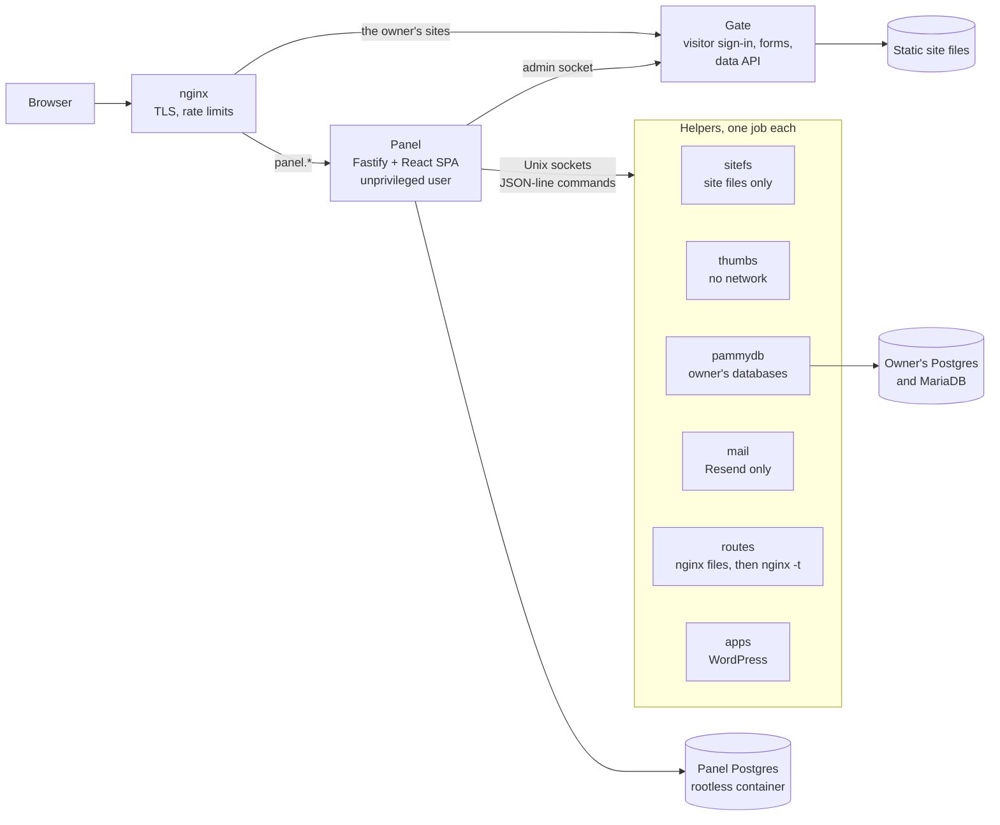

# PammyPanel architecture in five minutes

PammyPanel is a modular monolith wrapped in least-privilege helpers. One unprivileged Node.js process serves the panel. Anything that touches files, nginx, databases or mail goes to a small helper service, which does that one job and nothing else. This page covers the shape of the system, why it looks that way, and what is still wrong with it. The full analysis is in [architecture.md](architecture.md).

## The request path

- **Panel**: the admin app. It's a Fastify API plus a React single-page app, running as its own service user with its own Postgres.
- **Gate**: the visitor-facing server, which nginx consults on every request to a protected folder. It runs sign-in for site visitors, receives form posts and serves a read-only data API to the owner's pages.
- **Helpers**: each one is a separate systemd service under its own Unix user. It listens on a socket only the panel's group can open and accepts a short, fixed list of commands. The file helper can touch the website folder and nothing else. The thumbnail helper has no network. The mail helper can reach only the mail provider.

## Why it is built this way

**The owner should never need root, and neither should the panel.** The site owner used to have sudo on the server, and that access has since been removed. Every action she takes in the panel comes down to one narrow command to one helper. A bug in the web app can only ask helpers for things they already allow. All Node services run with `ProtectSystem=strict`, `ProtectHome=yes` and a system-call filter, and the databases run in rootless Podman containers.

**A few helpers do need root**, to write nginx config, manage WordPress, or start and stop services. These run their privileged steps as short-lived `systemd-run` units. The nginx writer follows plan, apply, check: write the files, run `nginx -t`, and put the old files back if the check fails.

**One process, many modules.** Each feature is a package in `packages/` (forms, media, studio, hosts and so on). Each package has its own routes, pages, web components and database migrations. A site profile in `sites/` turns modules on or off and wires them together. One codebase runs two differently shaped sites:
- pammy.org: one owner, WordPress, protected folders
- lesfleursdelanuit.com: five people, several domains, hosted apps

**Passkeys only.** Panel accounts have no passwords. New people and recovery both go through one-time setup links.

**Plain words in the interface.** The interface says "Installed software", not "apps", and "Wait for my OK", not "moderation queue". The owner is a 90s-era web builder, not a sysadmin. Every feature ships with a guide written for her.

## How changes reach the server

1. A written plan in `docs/`, with open questions and the owner's decisions.
2. Small steps. Each step runs `build.sh`, which covers type checks, unit tests, nginx tests in throwaway containers and two Playwright suites.
3. An install script run by a human with sudo, then a **verify script** against the live site, covering services, permissions, nginx, schema and pages. A step only counts as installed when verify passes.
4. Database moves and site switches get a rehearsal and a rollback before the real run.

## Tradeoffs we chose

| Choice | What it costs | Why it's worth it |
|---|---|---|
| Separate helper per concern | About 20 systemd units and sockets to install and keep in step | A web-app bug can't reach the filesystem, nginx or the network directly |
| Modular monolith, not microservices | Modules share a process and a database, so boundaries need discipline | One deploy and one set of transactions, the right size for a small server |
| Node 22 type stripping, no server build step | Needs Node ≥ 22.18, and some TypeScript features can't be used | `node src/server.ts` runs exactly what's in the repo |
| SERIALIZABLE transactions with retry by default | More retries on busy inserts | Correctness first for accounts and permissions |
| Verify on the live server after each install | Slower releases | Problems are found in minutes, by the script, not by the owner |

## Known debt (stated openly)

The [architecture review](architecture.md#5-coupling-problems-worst-first) found that import boundaries are clean but modules still reach each other in ways a boundary test can't see. Three of the worst:

- **The gate knows every module.** One switch with 79 cases dispatches admin commands, so a module can't add a gate command without editing the gate.
- **SQL across module lines.** The hosts tables are queried directly from five places, and `core` holds the store for areas, people and requests.
- **Duplicated site wiring.** The two site entry points share about 70% of their code and contain real module logic.

A generated [coupling report](coupling-report.md) lists every such dependency, and `test/coupling.test.ts` keeps it current. New coupling therefore shows up in review instead of slipping in. The fix is planned as a module registry with declared contracts and events ([module-contracts-plan.md](module-contracts-plan.md)), done in small steps without stopping the live sites.

## Where to read next

- [architecture.md](architecture.md): the processes, every module, 30 design patterns with file locations, and the full coupling list.
- [master-plan.md](master-plan.md): what has been built and what comes next.
- Any `*-plan.md`: one feature, from the question to the decisions to the run sheet.
