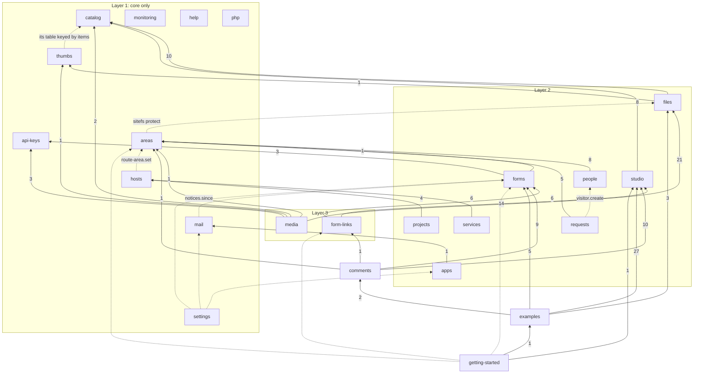

# Module dependency graph, and what the kernel really is

Written 2026-10-06 from `main` (98d1dc4). **Analysis only.** momolig: *"make a module dependency
graph and show how each module depends on the core (this should help us refine what the
core/kernel is)"*.

**How it was made.** Every `import … from '@panel/<pkg>/…'` in `packages/*/{src,web,widgets}`
(tests left out) was counted by a script; the core imports were also broken down by file and
by the names imported. Runtime dependencies (socket and gate ops, which imports don't show) come
from docs/architecture.md section 4. Declared needs are `NEEDS` in
`packages/core/src/profile.ts`. K0 (master plan, Track 0) will replace this hand-run with a
report generated on every build.

Related: docs/module-contracts-plan.md (the kernel, K-a / K-b), docs/modular-use-plan.md (must
have vs works with), docs/architecture.md (coupling problems).

## 1. Modules on modules

Solid: a static import (the number is how many import lines). Dotted: a runtime dependency
through a socket or gate op, which no `package.json` or `NEEDS` shows. Every module also imports
core (section 2); that edge is left out here so the rest can be read.

**The gate package** (the visitor-facing server, which becomes the kernel's gate host) imports
12 modules: areas 7, forms 9, examples 5, form-links 4, people 2, studio 2, media 2, api-keys 2,
comments 1, php 1, requests 1, plus core 24. That is coupling problem 1 (architecture.md); gate
step G6 makes modules build their own gate parts. **The sites** import everything; that is
their job.

### Declared vs real

| Module | `NEEDS` says | Imports show | Not declared anywhere |
|---|---|---|---|
| thumbs | catalog | core only | catalog by **schema**: `thumbs.thumbs` is keyed by catalog's items (catalog plan step 2); a table dependency, which rule 1's SQL check will show |
| forms | areas, mail, api-keys | areas (1: the page policy), api-keys (3: key covers) | mail is **reversed**: mail reads forms' notices, forms never calls mail |
| apps | mail, studio | mail (1: settings checks) | studio: runtime (pammydb) |
| examples | 8 modules | studio, forms, files, comments | areas, api-keys, form-links, apps: through gate ops |
| getting-started | help, examples, studio | examples, studio | forms, areas, form-links (runtime); help not imported |
| settings | — | core only | forms, apps, mail (runtime) |
| mail | — | core only | **forms** (runtime: `notices.since`): with forms needing mail, a **cycle** |
| areas | — | core only | files (sitefs `protect`) |
| hosts | — | core only | areas (`route-area.set`) |
| requests | areas | areas | people (`visitor.create`) |
| the rest | match | match | — |

**What it says for "only Forms"** (docs/modular-use-plan.md U2): Forms' real code needs from other
modules are one import of areas' page policy (signed-in-only forms) and api-keys' key covers
(the responses API). Mail is not a code need at all. All three are "works with", as the plan
suggests.

## 2. Every module on core

Core today is 6,390 lines in six kinds of thing. Four are what a kernel is; one is module
code that ended up in core; one is mixed.

| Piece | Files | Lines | What it is |
|---|---|---|---|
| **F. Foundation** | `config`, `pg`, `pg-migrate`, `paths`, `util`, `jsonline` (helper kit), `runner` (systemd-run), `signed`, `security` (client IP, rate limiter, page policy), `profile` (modules, words, facts) | 1,119 | kernel |
| **I. Panel identity, rights, Activity** | `accounts` (`AccountError`, `logActivity`), `sessions` (`Authed`), `panel/passkeys`, `panel/rights`, routes `accounts` / `sign-in` / `activity`, `cli-accounts` | 1,010 | kernel |
| **H. The hosts** | `panel/context` (`PanelCtx`), `panel/shell`, `panel/gate-http`; `gate/context` (`GateCtx`), `gate/site-routes`, `gate/live` | 813 | kernel, but `gate/context` and `gate/live` carry module parts (below) |
| **W. Browser kit** | `web/components` (page, shell, dialogs, ui/*), `web/hooks`, `web/lib`; `widgets/base.ts` (`PammyElement`) | 1,486 | kernel |
| **P. Panel pages** | Accounts, Activity, Invite, Login, Passkeys | 756 | kernel (they are piece I's pages) |
| **M. Module code living in core** | `gate/store` (612), `gate/passwords`, `gate/visitor-settings`, `panel/gate-shapes`, `manifest-catalog`, `nginx`, `names`; `web/components/folder-picker` | 1,145 + 127 | goes to its modules |

### The matrix

✓ = uses it. Under M, what it takes that belongs to a module.

| Module | F | I | H | W | M: module code it takes from core |
|---|---|---|---|---|---|
| mail | pg, jsonline | | | | — |
| thumbs | pg, jsonline | | | | `names.isSafeEntryName` (files') |
| api-keys | ✓ | ✓ | ✓ | ✓ | gate-op kit only (`GateError`) |
| catalog | ✓ + config, signed | ✓ | ✓ | ✓ | `manifest-catalog` (its own), `names.isSafeEntryName` |
| areas | ✓ | ✓ | ✓ gate | ✓ + widget base | **its own data in `gate/store`** (Area, AREA_TOKEN_RE, MARKER, openToAll, PAGES_READ), `gate/live` (Access, AreaLookup), `gate-shapes` (GateArea, GateVisitor, areaOf), `visitor-settings`, `manifest-catalog`, folder picker |
| people | ✓ | ✓ | ✓ gate | ✓ | **its own data in `gate/store`**, `gate-shapes` (GateVisitor), `visitor-settings`, `gate/context.VisitorMail` |
| requests | ✓ | ✓ | ✓ gate | ✓ | **its own data in `gate/store`** (addAccessRequest, addResetRequest, cleanVisitorName), `gate-shapes` (GateRequest) |
| settings | ✓ + profile | ✓ | ✓ | ✓ | `visitor-settings` (people's switches) |
| forms | ✓ + profile | ✓ | ✓ gate | ✓ + widget base | gate-op kit; **its own types in `gate-shapes`** (FormSummary, FormsState, FormFull); folder picker |
| form-links | ✓ | ✓ | ✓ | ✓ | gate-op kit; forms' types from `gate-shapes` |
| comments | ✓ | ✓ | ✓ gate | ✓ + widget base | gate-op kit; forms' types from `gate-shapes` |
| studio | ✓ + config, profile | ✓ | ✓ | ✓ | gate-op kit; `gate-shapes` (GateState, areaOf: areas') |
| files | ✓ + config, profile, security | ✓ | ✓ | ✓ | **its own rules in `names`** (isSafeEntryName, trashStamp, MARKER, SUBDOMAIN_RE, reservedNames, readPlacements) |
| media | ✓ + config, profile, security, paths | ✓ | ✓ gate (live, site-routes) | ✓ | `gate/live` (areas' Access, AreaLookup); folder picker |
| hosts | ✓ + runner, profile | ✓ | ✓ | ✓ | (its `nginx.ts` rendering sits in core) |
| services | ✓ + runner, signed | ✓ | ✓ | ✓ | — |
| projects | ✓ + runner, security | ✓ | ✓ | ✓ | — |
| apps | ✓ + runner, paths | ✓ | ✓ | ✓ | — |
| monitoring | ✓ | ✓ | ✓ | ✓ | — |
| help | ✓ | ✓ | ✓ | ✓ | — |
| getting-started | ✓ | ✓ | ✓ | ✓ | — |
| examples | ✓ + security, paths | ✓ | ✓ + gate-http | ✓ | gate-op kit; forms' types from `gate-shapes`; folder picker |
| php | — | — | — | — | — (nginx config and the gate's php socket only) |
| gate (host) | ✓ + profile | sessions | ✓ all of gate's | | areas' data from `gate/store`; `gate/context` mailer; `gate/live` |

### Used by nearly everyone: the real kernel API

| Name | From | Modules | It is |
|---|---|---|---|
| `pg` | foundation | 21 | the database |
| `AccountError`, `logActivity` | `accounts` | 20 | errors people read, and Activity |
| `useApi`, `useAction`, `api`, routes, page, badge, button | browser kit | 19-20 | the panel's page frame |
| `PanelCtx` | `panel/context` | 19 | what a panel module is given |
| `jsonline` | foundation | 12 | the helper kit |
| `need`, rights | `panel/rights` | 12 (all routes use `needs`) | who may |
| `Authed` | `sessions` | 11 | who is asking |
| `GateError`, `cleanLine`, `cleanMessage`, `cleanBy`, `int`, `logEvent` | **`gate/store`** | 10 | the **gate-op kit**: errors and input cleaning for gate ops |
| `isOn(site, module)` | `profile` | ~20 calls in 11 packages | "is that module here?": today's ad-hoc *works with* |

## 3. What this says about the kernel

**1. The kernel is smaller and clearer than core.** About 5,200 of core's 6,400 lines are kernel
(F, I, H, W, P). The rest (M, ~1,270 lines) is module code. K-a and K-b already move most of it.
This graph adds four the plans don't name:

| Module code in core | Goes to | Step |
|---|---|---|
| `gate/store.ts`: areas', people's, requests' data | areas / people / requests | K-a (planned) |
| `gate/store.ts`: `GateError`, `cleanLine`, `cleanMessage`, `cleanBy`, `int`, `logEvent` | **stays in the kernel** as the gate-op kit (`kernel/gate/ops`): 10 modules use only this part | K-a (**new**: name it, so the split doesn't push it into areas) |
| `panel/gate-shapes.ts`: forms' types (FormSummary, FormsState, FormFull) and areas' (GateArea, GateVisitor, areaOf) | forms' and areas' `src/shared/` (rule 9) | K-b (**new**) |
| `gate/visitor-settings.ts`, `gate/passwords.ts` | people (switches read by settings through people's API) | K-a (planned for passwords; **new** for visitor settings) |
| `gate/context.ts`: `VisitorMail`, `socketMailer` | mail, behind the mail sender contract (12) | C2-rest / MS1 (**new** detail) |
| `gate/live.ts`: `Access`, `AreaLookup` | areas, registered as a cache (gate G4) | K-b (planned) |
| `names.ts`: entry names, trash stamps, `SUBDOMAIN_RE`, `MARKER`, placements | files (`isSafeEntryName` may stay as a kernel building block: catalog and thumbs use it too) | K-b (**new**) |
| `manifest-catalog.ts`, `nginx.ts` | catalog, hosts | K-b (planned) |
| `config.ts`: ten module sockets (sitefs, thumbs, pammydb, apps, mail, routes, projects, services…) | registered by their modules | K-b (planned) |
| `web/components/folder-picker` | see 3 below | K-b (**new**) |
| `isOn('apps' / 'hosts')` in `routes/accounts.ts`; `isOn('php' / 'examples' / 'projects')` in `nginx.ts` | place kinds (3 below); hosts | K-b (planned for nginx) |

**2. Four kernel concepts are used everywhere but not named as such.** The kernel should own
them, as interfaces:
- **Activity** (`logActivity`, 20 modules): already kernel; keep it, add a typed entry per
  module (the event plan's "Activity" reader later).
- **The gate-op kit** (10 modules): errors and input cleaning for anything the gate serves.
- **Who is asking** (`Authed`, `need`, rights): panel side done; the visitor side is the
  identity contract (contract 5, C6-min).
- **"Is that module here?"** (`isOn`, ~20 calls): becomes `use.has()` with `worksWith`
  (modular-use plan U1), so every such call is declared, not found by grep.

**3. One kernel concept is missing: places.** Rights have *places* (a folder on pammy, a host on
lfdln, a WordPress's files), and the kernel checks them, but **what a place is** comes from
modules: files (folders), hosts (hosts), apps (software). Today core knows them by name
(`isOn('apps')`, `isOn('hosts')` in `routes/accounts.ts`) and the folder picker lives in core.
Suggestion: a **place kinds** extension point owned by the kernel; files, hosts and apps fill it
(how to list, how to pick, how to say "is X inside place P"); the picker becomes a kernel
component that asks the registered kinds. Then the kernel names no module, and "kept to places"
works with whatever modules are on.

**4. Three layers sit above the kernel, and one is too high.** Layer 1 (mail, api-keys, catalog,
thumbs, areas, hosts, monitoring, help, settings, php) depends on the kernel only. Comments
sits at layer 4 because it imports forms, form-links and studio. After U3 (Comments as a Forms
plugin) it needs forms alone, and studio / form-links become works-with.

**5. Two runtime cycles to break**:
- **mail ↔ forms**: mail polls forms' notices while forms declares it needs mail. Fix: forms
  publishes `forms.response.kept` (C4) and mail (the Notifier) subscribes; forms no longer needs
  mail (matches U2).
- **settings → forms, apps, mail**: Settings is a page holder that reaches into three modules.
  Fix: a **settings sections** extension point; each module adds its own section.

## 4. Essentials (decided 2026-10-06)

Always on: the kernel (panel accounts), `hosts`, `areas`, `people`, `requests` (ES-Q2), `mail`
(ES-Q1), a new `backups` module, `monitoring`. Everything else is off until turned on (docs/modular-use-plan.md
section 0). From the graph, the essentials lean on optional modules in three places: areas →
files (the sitefs helper, for protected folders), people and monitoring → mail, backups → studio /
services. The fixes are hosts' **folder** place kind, mail essential (ES-Q1, decided), and the
backup and health contracts.

## 5. Suggested additions to the plans (DECIDED 2026-10-08: momolig took them)

Now in module-contracts-plan section 4 and master-plan's K-a / K-b rows; settings sections and
module-settings-plan's U11 are one mechanism.

- **K-a**: name the gate-op kit and keep it in the kernel; move visitor settings to people.
- **K-b**: `gate-shapes` split to forms / areas `shared/`; `names` to files (keep
  `isSafeEntryName` as a building block); **place kinds** extension point and the picker as a
  kernel component; **settings sections** extension point.
- **NEEDS cleanup at C1**: keep thumbs → catalog but mark it a schema need; forms' mail
  need goes when C4 lands (or at U2 as works-with); mail's and settings' hidden needs declared.
- **K0**: generate this document's tables (imports, core names per module, declared vs real) on
  every build, so it can't go stale.
